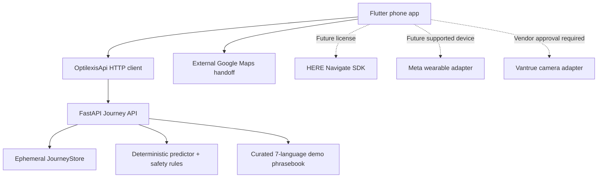
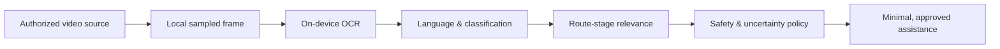

# Optilexis mobile starter architecture

The Word specification under `docs/` is the authoritative product baseline. These code-oriented diagrams document the initial implementation and target interfaces.

## Sprint 01 interfaces

## Vision inference target (not implemented)

## Scope boundaries

- Phone navigation state is independent of external Maps. Handoff never creates fake route progress.
- Prediction source in Sprint 01 is **simulation**, explicitly labeled by API and UI.
- No microphone, GPS or camera access is requested in the starter.
- `spoken_output_allowed` is always false until the TTS and safety stack is implemented.
