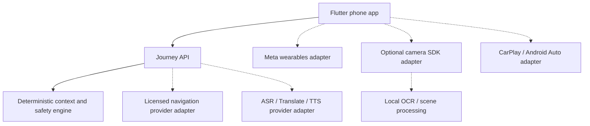

# Optilexis MVP — implementation requirements

**Product:** Optilexis — One journey. Every language.  
**Audience:** international travelers, initially walking-first; vehicle journeys are a later, gated extension.  
**Source:** `Optilexis_Mobile_App_Technical_Architecture_and_Development_Plan.docx` supplied in the planning conversation. This Markdown records the coding requirements; it is not a claim that all capabilities are implemented.

## Product goals

1. One mobile journey with destination, traveler language, mode, route session and preference/consent controls.
2. Context-aware *predictive* suggestions tied to actual journey events and relevant places.
3. Speech translation using explicitly configured providers and on-demand input; no unconsented background recording.
4. Audio-first support for supported Meta wearables with a phone-only fallback.
5. Optional vehicle integration via approved platforms; optional Vantrue or other dash camera, never a dependency for the core MVP.
6. Transparent capability reporting and clear simulation labels until integrated hardware or provider data is validated.

## Boundaries and non-goals

- Google Maps / Apple Maps handoff **does not** expose turn-by-turn events to Optilexis.
- Accurate route progress requires an Optilexis-owned licensed navigation provider (HERE Navigate is a candidate).
- Vantrue E1 Pro S 4K recording, GPS and Wi-Fi **do not** establish a public live-video API. Obtain licensed SDK/authorization and validate iOS/Android networking before developing the adapter.
- Published Vantrue GPL/kernel code does **not** constitute a camera SDK.
- CarPlay and Android Auto interfaces require appropriate native integration, category eligibility, platform review and driver-distraction safeguards.
- Demo phrasebook is not machine translation. Do not fabricate live speech, GPS, LLM, camera, or SDK behavior.

## Main subsystems

Dashed integrations above are design goals, not confirmed in Sprint 01.

## First real customer pilot requirements

- Native iOS + Android app with robust trip lifecycle, opt-in location/mic permissions, locale selection, accessible UI, session history and error handling.
- One true navigation SDK owns the active route and emits timestamps, location, upcoming turns and off-route events. No synthetic live telemetry.
- Streaming ASR -> translation -> speech output on connected, supported real glasses and phone; record actual latency and failures.
- Context intelligence predicts short relevant phrases based on destination and *verified* route progress; deterministic driving safety policy takes precedence.
- Secure accounts and per-user access, persistent session state, limited retention, opt-in consent, secure transport, observability and abuse controls before public access.

## Pilot metrics to validate, not current performance

- >=80% participants complete a planned walking scenario with useful language assistance.
- >=90% correct supported Maps app handoffs.
- <=3 second median speech-to-response under defined network test conditions, with p95 tracked.
- >=4.2/5 average usefulness rating across completed surveys.
- Zero unresolved critical permission/privacy/driver-distraction issues at public beta gate.

## Proposed stage gates (2026–2027)

| Date | Objective |
|---|---|
| 2026-11-27 | Product requirements and pilot success measures approved |
| 2026-12-11 | Meta SDK feasibility + Vantrue interface discovery |
| 2027-01-08 | Secure mobile journey experience and Maps handoff |
| 2027-02-19 | Translation and owned-navigation alpha |
| 2027-03-19 | Meta glasses tested on real supported devices |
| 2027-04-09 | Limited beta safety/privacy approval |
| 2027-04-30 | Vehicle/car-display/camera feasibility review |
| 2027-05-07 | Scoped release go/no-go |

## Engineering quality gates

- Production authentication, authorization, persistent storage, secure data handling, and documented consent decisions.
- Driving-state policy suppresses non-navigation suggestions while moving.
- Real service integrations are separately feature-flagged with explicit availability reports.
- 30–50 consenting users across two languages and settings proposed for pilot, subject to feasibility.
- Document SDK and hardware access prerequisites, never invent data.

See `docs/ARCHITECTURE.md`, `docs/IMPLEMENTATION_MATRIX.md`, `codex/SPRINT_02.md`, and `AGENTS.md` for development instructions.
